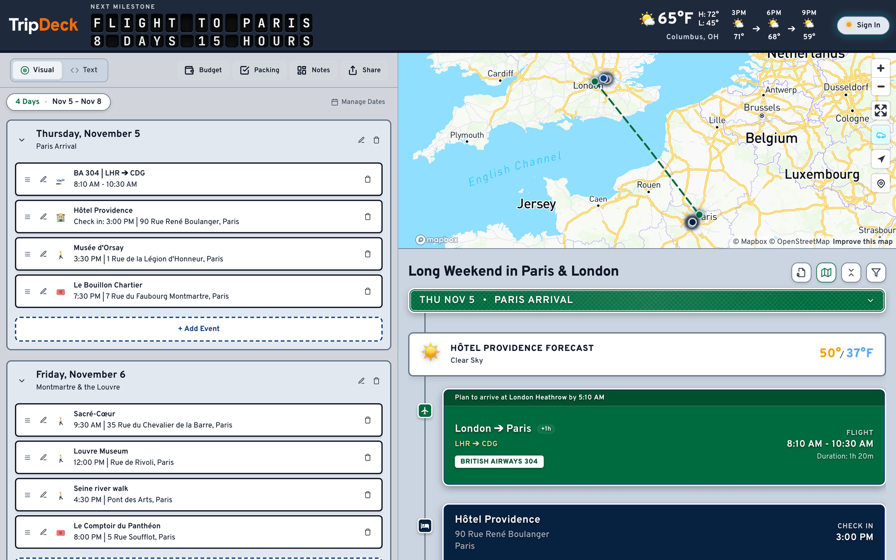
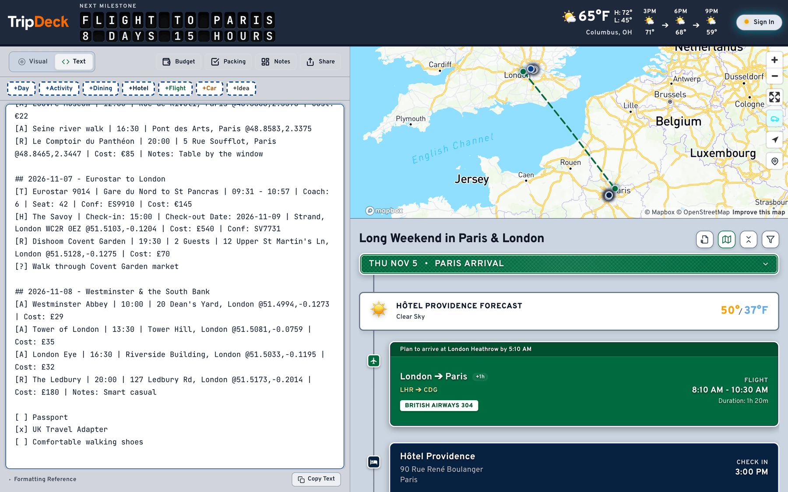
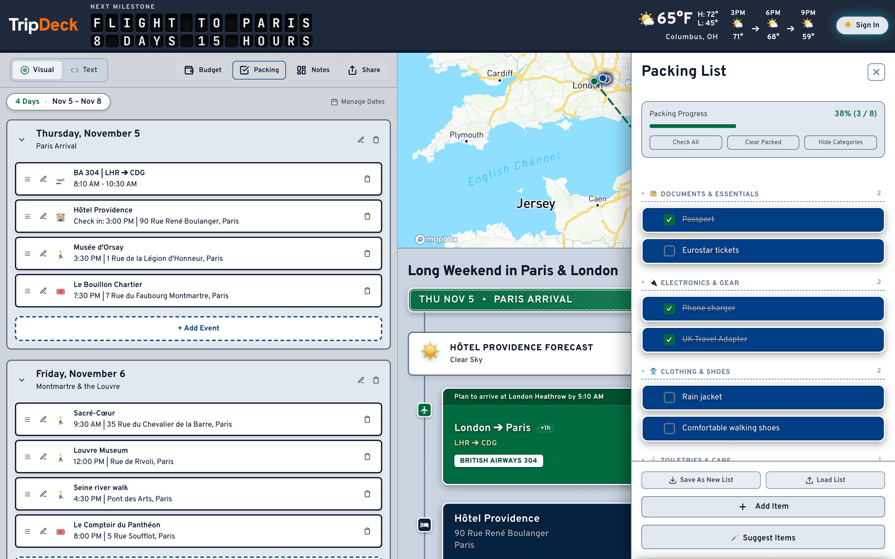
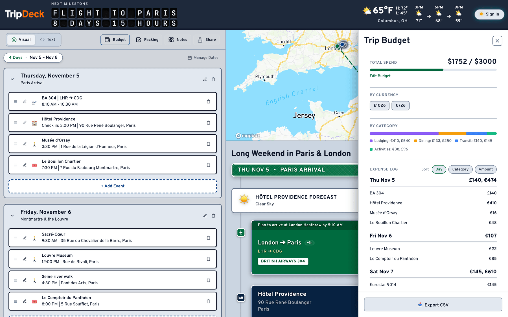
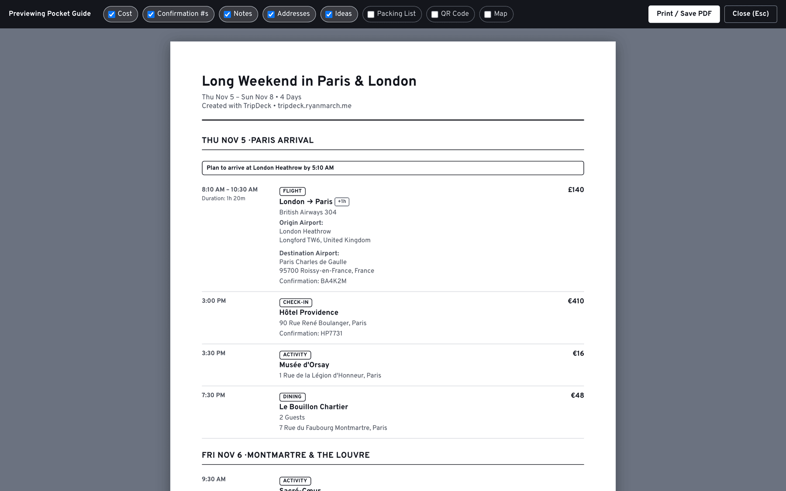
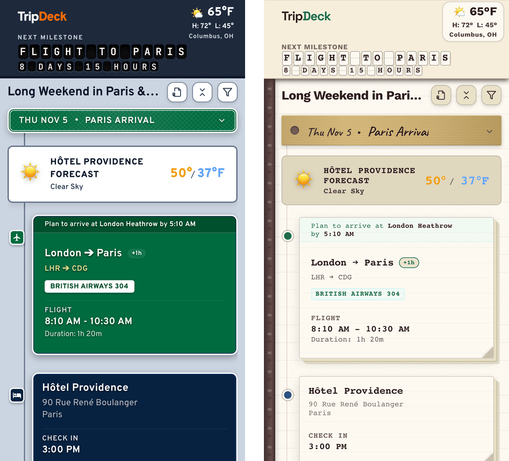
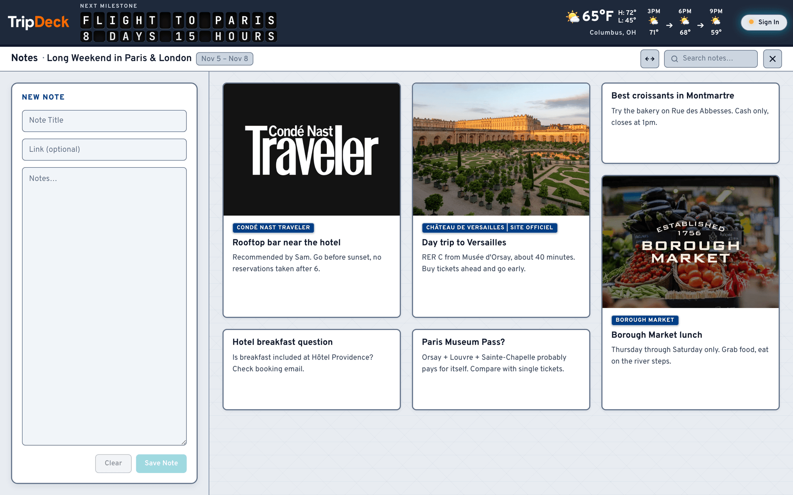

  

<h1 align="center">TripDeck</h1>

<em>Trip planner and travel companion.</em>

  

  

TripDeck is a trip planner for people who are tired of juggling confirmation emails, notes apps, and spreadsheets. Build your schedule in a visual timeline or type it in plain text, and TripDeck fills in the maps, weather, flight times, and costs. It works on your phone, and it keeps working when your signal doesn't.

## Features

### Build it visually or type it out
Search for a place or drag flights, trains, hotels, reservations, and activities into a day-by-day schedule, or write the whole trip as plain text and paste it in. Both views edit the same itinerary, so you can switch whenever one is faster.

  

### See the whole trip at a glance
Every stop lands on the map automatically, each day shows its forecast, and a countdown ticks toward your next flight or check-in. Enter a flight number and TripDeck fills in the route and times. Add a restaurant or attraction and it pulls in opening hours, a phone number, and a website. TripDeck also warns you about tight connections and gives you directions links for each stop.

### Pack for the weather you'll actually get
Check the hourly and 7-day forecast for every stop on your route, along with wind, UV, air quality, and a radar view. TripDeck suggests what to bring based on your plans and the weather, and you can save your own lists to reuse on the next trip.

  

### Keep an eye on spending
Add a cost to any event, set a budget, and see totals by day and by category. Costs in other currencies are converted using European Central Bank rates, and you can export everything as a CSV for expense reports.

  

### Share a trip without sharing everything
Send a view-only link that leaves out confirmation numbers, notes, and ideas. Or send a collaboration link so travel companions can edit alongside you. Trips are fully end-to-end encrypted.

### Take it on paper
The Pocket Guide turns your itinerary into a clean printable agenda or PDF. Choose what goes on it: costs, confirmation numbers, notes, addresses, your packing list, a map, or a QR code that opens the live trip.

  

### On your phone, your way
On a phone, enjoy an easy-to-use tab bar for the timeline, the map, the packing list, and your notes. Pick a look that suits you, from the bright Roadtrip default to Vintage Journal and more themes to choose from.

  

### Collect ideas before you commit
Save links, hotel listings, and restaurant recommendations to a notes board. Links show a preview, and you can search your notes and move any of them onto the schedule with a click.

  

### The little things

- Themes including Roadtrip, Slate Dark, Vintage Journal, Terminal Light, Velocity, and Start95.
- A split-flap countdown to your next departure
- Passkey sign-in to sync across your devices
- Keep several trips and find them again with search and sorting
- Shift every date in a trip forward or back at once
- Keyboard shortcuts for the things you do most
- A recovery key, so you're never locked out of your own trips
- Reusable packing lists and other lists
- A bookmarklet for saving travel research as you browse
- Venue hours, phone numbers, and ratings
- Offline access once the app has loaded

## How it's built

TripDeck is plain HTML, modern CSS, and vanilla JavaScript modules, with no heavy frontend framework or bundler.

That means the app loads lightning fast, and it stays fast even on spotty wifi.

## Privacy-first

TripDeck believes in dignity and privacy. Your trips are stored in an encrypted format, and can only be seen by you and those you share with. No one, not even the developers, can access your trip data. Learn more in our [Terms & Privacy Policy](https://tripdeck.ryanmarch.me/terms.html).

## Help & Documentation

New to TripDeck? The [Help Center](https://tripdeck.ryanmarch.me/docs/) has guides for building a trip, writing in the text editor, budgets, packing lists, sharing, the Pocket Guide, passkeys, and working offline.

## Community & Feedback

- **Feature Requests**: Have an idea for a travel tool or workflow? [Open a feature request](https://github.com/RyanMarch/tripDeck/issues/new?template=feature_request.md).
- **Bug Reports**: Notice a flight lookup issue, display glitch, or calculation error? [Submit a report](https://github.com/RyanMarch/tripDeck/issues/new?template=bug_report.md).

---

## Credits & Attributions

TripDeck relies on the following third-party APIs, services, and open-source libraries:

- **[Mapbox](https://www.mapbox.com/)**: Interactive map rendering, geocoding, and map styles ([Mapbox TOS](https://www.mapbox.com/legal/tos/)), with data (c) [OpenStreetMap contributors](https://www.openstreetmap.org/copyright).
- **[AeroDataBox](https://aerodatabox.com/)**: Primary live flight status, gate, terminal, and flight schedule data.
- **[AirLabs](https://airlabs.co/)**: Live flight route, gate, and schedule fallback data.
- **[HERE Technologies](https://developer.here.com/)**: Venue discovery, contacts, opening hours, and location enrichment data.
- **[Google Places API](https://developers.google.com/maps/documentation/places/web-service)**: Venue autocomplete, search, and address metadata.
- **[Transitland](https://www.transit.land/)**: Public transit stops, train station metadata, and route geometry data ([Transitland Terms](https://www.transit.land/terms), licensed under [CC BY 4.0](https://creativecommons.org/licenses/by/4.0/)).
- **[Open-Meteo](https://open-meteo.com/)**: Real-time and hourly weather forecasts and air quality metrics ([Open-Meteo Terms](https://open-meteo.com/en/terms), licensed under [CC BY 4.0](https://creativecommons.org/licenses/by/4.0/)).
- **[Frankfurter](https://www.frankfurter.dev/)**: Currency conversion rates sourced from the European Central Bank.
- **[QR Maker](https://qrmaker.ryanmarch.me/)**: Vector QR code generation for printed Pocket Guide itineraries.
- **[tz-lookup](https://www.npmjs.com/package/tz-lookup)**: Offline timezone coordinate boundary lookup (licensed under [CC0-1.0](https://creativecommons.org/publicdomain/zero/1.0/)).

---

© 2026 Ryan March · <a href="https://ryanmarch.me">ryanmarch.me</a>   <a href="https://tripdeck.ryanmarch.me/terms.html">Terms &amp; Privacy</a>

